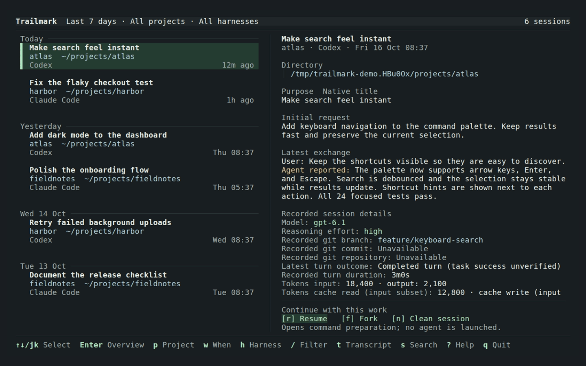

# Trailmark

A local, keyboard-first TUI for remembering recent coding-agent work and deciding how to continue it.

See what you worked on over the last few days, recognize each session's purpose and project path, and decide whether to resume it, fork it, or start a clean session in that area.

*Recorded from the application using fictional sessions. [Recreate the demo](tapes/README.md).*

**Status:** MVP implemented (Phases 1–5) — recent-work overview, continuation preparation and copying, transcript reading, content search, and sources/settings with the full derived-data lifecycle. Performance measurements are in [docs/benchmarks.md](docs/benchmarks.md) and scripted validation in [docs/validation.md](docs/validation.md). The project name has not been cleared.

## Core workflows

- **Remember recent work:** scan a seven-day overview across projects and agents without having to enter a search query.
- **Choose how to continue:** compare a session's purpose, directory, and latest context before choosing resume, fork, or a clean session.
- **Inspect when needed:** open the transcript or search its contents to resolve a question. This is a secondary MVP workflow.

## First release

- Linux, with native Claude Code and Codex session logs.
- Choose how much history to index on first launch, then follow a dedicated progress screen. Press Esc to stop and browse sessions already saved; later launches open cached sessions immediately while refreshing in the background.
- Launch `trailmark` into the last seven days, grouped by day and ordered by last session activity. If that scope is empty, automatically try 30 days, then All time, to show available history.
- Use the time selector to show Today, 3 days, 7 days, 30 days, or All time. An explicit time choice stays fixed; otherwise choosing a project or harness automatically finds the smallest populated window from 7 days, 30 days, and All time. The seven-day default does not limit retained history.
- Choose Green, Blue, Amber, or Monokai in settings (`,` → Theme); the choice is saved and adapts to light/dark terminals.
- Keep the launch interface to `trailmark`, `--help`, and `--version`; normal operations live inside the TUI.
- Scan compact session cards that give purpose and project/path visual priority, with an adjacent overview where space permits.
- Switch between all projects and the current project while keeping repository and worktree context visible.
- Filter by harness with `h`: All harnesses, Codex, or Claude Code. Combine it with time and project filters; the same scope applies to transcript-content search.
- Show a purpose label from the native title or a clearly labeled request excerpt, plus the latest substantive exchange. An agent's completion claim is not proof of success.
- Inspect recorded models, reasoning effort, Git context, token usage, and latest-turn outcome in the Overview. Press `e` with Overview focused to expand recorded file and command activity; missing provider data is explicitly unavailable.
- Present resume, fork, and clean-session choices with their history behavior and exact target directory. The first release prepares/copies validated native commands where supported; it does not launch agents.
- Read transcripts, search their contents with matching snippets and passage navigation, and explicitly copy selected context with its source reference.
- Keep source logs read-only and session data on-device, with exclusion controls, cache clearing, and visible indexing status.

Next enhancements include bookmarks, personal labels, previewable Markdown context export, and related-session navigation. Semantic search, generated summaries, and additional adapters are deferred until the recent-work overview is validated. Future adapters may include GitHub Copilot CLI, Muse Code, Pi, and OpenCode.

## First-run indexing and speed

The first launch builds a local index of your Claude Code and Codex logs.
Choose files modified in the **last 7 days**, **last 30 days** (recommended),
or **all history**. You can expand this later under **Sources and settings**
(`,`) → **Indexing scope**. The cutoff uses the log file's modification time,
not dates inside the conversation. It skips older files that have never
been indexed; sessions already cached remain available and are refreshed.
The `w` time filter changes what you see, not what gets indexed.

**A large archive can take hours to index.** A development benchmark of
10,000 synthetic sessions (1.19 GiB of logs) recorded approximately
**2 hours 18 minutes of CPU time**, producing a **2.9 GiB index**. Opening
the cached list of those sessions took **103 ms**. These are historical
measurements on one machine, not a wall-clock estimate for your collection
or a fresh benchmark of this release. Log size, message count, disk speed,
and CPU matter more than session count alone. See the
[benchmark setup and limitations](docs/benchmarks.md).

Start with recent files to avoid parsing an entire archive. A large recent
log can still take time: the progress screen remains animated while a file
is being processed, even if the counts are unchanged. **Esc** stops the
scan and opens sessions already saved; the next scan reuses completed,
unchanged files and retries the interrupted file. Source logs stay read-only.
The new progress screen and scope options make indexing controllable;
they do not speed up parsing or database writes for files you include.

## Requirements

- [Market Requirements Document](MRD.md)
- [Product Requirements Document](PRD.md)
- [TUI experience and wireframes](UX.md)
- [Visual specification](UX.md#8-visual-and-state-rules) — mockup colors, session selection, separators, spacing, and terminal adaptations; [visual acceptance criteria](PRD.md#visual-acceptance).
- [Interactive TUI concept](docs/mockups/index.html) — open locally in a browser; fictional sessions, with no connection to real logs or agents.

## Technology direction

Go, using the Charm TUI stack described in the PRD: Bubble Tea v2, Bubbles, and Lip Gloss v2. This follows the stack already used by the local gh-boardwalk project. Cobra may handle the minimal launch interface.

## Development

`make check` runs vet and tests; `make build` builds `./trailmark`. Provider contracts are recorded in [docs/providers.md](docs/providers.md), and configuration and data locations in [docs/configuration.md](docs/configuration.md).

The README animation is recorded with [VHS](https://github.com/charmbracelet/vhs). Its [tape and fixture generator](tapes/README.md) run the normal application in an isolated temporary workspace.

## License

[MIT](LICENSE).
